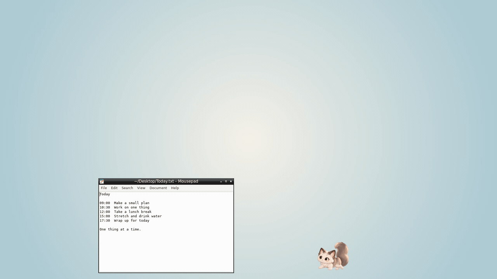

# Mischief Pet 0.6.0

A little companion for your desktop — a desktop cat for **Windows, macOS and Linux (beta)** by **Neo Genesis** that roams, peeks and naps beside your work. Feed, pet and name your friend. No app account; pet saves stay on your device.

**Free:** 3 Focus Buddy trials + 3 Window Perch trials. A Focus trial is used only after 2 minutes or on completion; stopping earlier uses none. Water/stretch reminders are Plus-only, with no trial. Core care, movement, settings, instant hide (**Ctrl+Shift+H on Windows/Linux / ⌘+Shift+H on Mac**), reduced motion. No forced startup. On Linux, Window Perch requires X11 (EWMH window manager with restacking, libX11, 100% display scaling / scale 1); not available on Wayland.

**Plus:** Focus Buddy, optional water/stretch reminders and Window Perch. US$4.99, one-time purchase, no subscription (tax calculated at checkout). Activate your Gumroad license key in the app's Plus settings; initial verification needs internet and your operating system's secure storage. Let the first activation finish before quitting the app; if it was interrupted, reopen the app and enter the key again. The same download includes Free and optional Plus. On Linux, Window Perch requires X11 (EWMH window manager with restacking, libX11, 100% display scaling / scale 1); not available on Wayland.

- [Official website](https://mischiefpet.neogenesis.app)
- [Get Plus on Gumroad](https://neogenesis4.gumroad.com/l/mischief-pet?variant=Plus&wanted=true)
- [Free download on itch.io](https://neogenesis-studio.itch.io/mischief-pet)
- [Privacy policy](https://mischiefpet.neogenesis.app/en/privacy/) · [Terms](https://mischiefpet.neogenesis.app/en/terms/) · [Refunds](https://mischiefpet.neogenesis.app/en/refund/)
- Support: [mischiefpet@neogenesis.app](mailto:mischiefpet@neogenesis.app)

## Downloads · 다운로드 / SHA-256

Free installers are direct GitHub downloads, without email. Get one file for your OS/chip from [v0.6.0 Releases](https://github.com/Yesol-Pilot/mischief-pet/releases/tag/v0.6.0). 내 OS/칩에 맞는 파일 하나를 받으세요.

| OS / architecture · OS / 아키텍처 | File / 파일 | SHA-256 |
| --- | --- | --- |
| Windows x64 · installer / 설치형 | [`Mischief-Pet-Setup-0.6.0.exe`](https://github.com/Yesol-Pilot/mischief-pet/releases/download/v0.6.0/Mischief-Pet-Setup-0.6.0.exe) | `a26917983e8b88f9f4f3abb90154b97faaa4480badcd4c76a1f6f7764fb14ae0` |
| Windows x64 · portable ZIP | [`Mischief-Pet-0.6.0-Windows-x64.zip`](https://github.com/Yesol-Pilot/mischief-pet/releases/download/v0.6.0/Mischief-Pet-0.6.0-Windows-x64.zip) | `0e2b4dd94bb19f67bee09a43ce01ea9130569b0648cdf0ff77ee1484ba638845` |
| macOS Apple silicon (arm64) · DMG | [`Mischief-Pet-0.6.0-macOS-arm64.dmg`](https://github.com/Yesol-Pilot/mischief-pet/releases/download/v0.6.0/Mischief-Pet-0.6.0-macOS-arm64.dmg) | `d85d29eb0a53e4402688ec829f1074e39359fe65b72b8648c68797b2226f5197` |
| macOS Apple silicon (arm64) · ZIP | [`Mischief-Pet-0.6.0-macOS-arm64.zip`](https://github.com/Yesol-Pilot/mischief-pet/releases/download/v0.6.0/Mischief-Pet-0.6.0-macOS-arm64.zip) | `42ca5db3207702c253a03d5aac7a53a02772908780e78b3e3a7e6433d8c6484a` |
| macOS Intel (x64) · DMG | [`Mischief-Pet-0.6.0-macOS-x64.dmg`](https://github.com/Yesol-Pilot/mischief-pet/releases/download/v0.6.0/Mischief-Pet-0.6.0-macOS-x64.dmg) | `47c5e7c45626b8810483abe1a0ea638189a48799f12df7270626e6ddd954c8c7` |
| macOS Intel (x64) · ZIP | [`Mischief-Pet-0.6.0-macOS-x64.zip`](https://github.com/Yesol-Pilot/mischief-pet/releases/download/v0.6.0/Mischief-Pet-0.6.0-macOS-x64.zip) | `3bad4ece61ff706d05847d0c240f8fbac7a3e905c1f7cd4d1cbd5e5dc4e9deae` |
| Linux beta · x64 (amd64) · Debian package | [`mischief-pet_0.6.0_amd64.deb`](https://github.com/Yesol-Pilot/mischief-pet/releases/download/v0.6.0/mischief-pet_0.6.0_amd64.deb) | `48e35d239083bbbe5e512e94c35615edc80c86611cfb967010eaed1673fff1e8` |
| Linux beta · arm64 · Debian package | [`mischief-pet_0.6.0_arm64.deb`](https://github.com/Yesol-Pilot/mischief-pet/releases/download/v0.6.0/mischief-pet_0.6.0_arm64.deb) | `cf7697ac3d6666312929db497b9853566ec2fea4ff28d6d6ce5b7a2dfa11318f` |

SHA-256 values are also published as `SHA256SUMS.txt` in the v0.6.0 release. / SHA-256 값은 v0.6.0 릴리스의 `SHA256SUMS.txt`에도 있습니다.

## What’s new in 0.6.0

- First-run welcome helps you name your pet and learn click, drag, right-click and hide controls. Revisit “How to play” from the manager or tray.
- The manager’s X hides that window to the tray while the pet stays. To end the app, choose Quit in the manager, tray or pet’s right-click menu.
- Choose launch at login on supported installed builds. It is off by default, with equal choices in the welcome. Windows ZIP builds do not register startup. On Mac, launch at login requires macOS 13 or later; it is unavailable on macOS 12.
- Fullscreen courtesy hide is on by default where supported. The pet returns afterward without undoing your own hide choice.
- Hide with Ctrl+Shift+H on Windows/Linux or ⌘+Shift+H on Mac. If registration fails, the app tries Ctrl+Alt+H / ⌘+Alt+H; use tray Hide immediately if needed.
- Daily and return greetings, sleepier nights, breathing, eased walking and squash-and-stretch motion. Drag the pet to move it even during Focus.
- Free care days unlock bond levels and little gifts: 0 days Just met; 1 Familiar faces and an Apricot ribbon; 3 Friends and a Yarn buddy in the care window; 7 Close friends and a Little golden bell; 14 Best friends and Paw hello; 30 Family and a Family star charm. Three feeds, pets or playtimes at least 20 seconds apart make one care day. No streak required; levels and gifts stay when you take a break.
- Send feedback opens the support email from Settings. Memory use is reduced.
- Direct builds enable GitHub update checks by default, independently of statistics consent. Checks run only after the first-run or What’s-new welcome is completed; manual checks also wait until then. While the app runs, automatic checks occur at most once every 24 hours, including failed attempts; manual checks may bypass that interval. Checks show a notice, never download automatically, and can be turned off in Settings. Microsoft Store builds make no GitHub check and use Store-managed updates. No pet name, license key or statistics identifier is sent; GitHub (USA) receives IP and connection data.

## Window Perch

Use a non-maximized window with about a cat’s height of space above it. On Linux, X11 is required (EWMH window manager with restacking, libX11, 100% display scaling / scale 1); unavailable on Wayland.

## Privacy and internet

Saves stay local and no app account is required. Usage statistics (no name or email; random ID) are off by default and sent to PostHog, Inc. (USA) only after explicit opt-in. Receiving services see IP and connection data. Statistics include app-open and launch source (manual/login), care, Plus feature, onboarding, startup and update events, version, OS and language, but never screens, window titles, microphone, files or license keys. Declining keeps all features available; change your choice anytime in Settings. Consent version 2 in 0.6.0 resets legacy grants and asks again; existing denials are kept. Entering a Plus key triggers Gumroad license verification and rechecks; purchaser email is not stored by the app. Gumroad checkout has its own privacy policy. Direct builds enable GitHub update checks by default, independently of statistics consent. Checks run only after the first-run or What’s-new welcome is completed; manual checks also wait until then. While the app runs, automatic checks occur at most once every 24 hours, including failed attempts; manual checks may bypass that interval. Checks show a notice, never download automatically, and can be turned off in Settings. Microsoft Store builds make no GitHub check and use Store-managed updates. No pet name, license key or statistics identifier is sent; GitHub (USA) receives IP and connection data.

## Requirements and installation

**Platforms:** Windows 10/11 x64; macOS 12 or later, Apple silicon (arm64) or Intel (x64). Tested on macOS 26. **Linux beta is available for x64/arm64 (.deb only).**

Quit fully before updating or removing Mischief Pet, and wait until the app has completely closed (on a Mac, until Mischief Pet no longer appears in Activity Monitor).

**Known macOS quit limitation:** one instrumented release test left the main process running for about 39 seconds after the windows and helpers closed; it then exited normally. The cause is still unknown and later diagnostics did not reproduce it. Before relaunching, updating or removing the Mac app, wait until Mischief Pet is no longer listed in Activity Monitor.

### Windows

Run `Mischief-Pet-Setup-0.6.0.exe`. It installs for the current user without administrator rights and creates a Start-menu shortcut. Alternatively, fully extract `Mischief-Pet-0.6.0-Windows-x64.zip`, keep all files together and run `MischiefPet.exe` outside the ZIP. Quit from the tray menu before uninstalling in Windows Settings → Apps, or deleting the extracted ZIP folder. Local saves are kept; export anything important from Settings first.

**Windows-only unsigned / SmartScreen note:** the Windows release is not code-signed. Windows may show “Windows protected your PC.” Verify the official download URL and SHA-256 above. Only if you trust the download, select **More info → Run anyway**. Do not disable Windows security or bypass work/school device policies.

### Mac

Choose **arm64 for Apple silicon** or **x64 for Intel** (Apple menu → About This Mac). Open the matching DMG, drag Mischief Pet to Applications and launch. For the matching ZIP alternative, fully extract it, move Mischief Pet to Applications and launch.

The Mac app is **Developer ID-signed and notarized by Apple**. The first time you open it, macOS may ask you to confirm — that is normal for apps downloaded outside the App Store. It runs from the **menu bar with no Dock icon**. Hide instantly with **⌘+Shift+H**. Before removal, **quit from the menu-bar menu**, then delete Mischief Pet from Applications. Local saves remain in `~/Library/Application Support`. Export anything important from Settings first.

### Linux beta (.deb only)

Linux beta (.deb only): choose `mischief-pet_0.6.0_amd64.deb` for x64 or `mischief-pet_0.6.0_arm64.deb` for arm64. Install with `sudo apt install ./mischief-pet_0.6.0_amd64.deb` (or `sudo apt install ./mischief-pet_0.6.0_arm64.deb`). Launch “Mischief Pet” from the app menu (Utility/Amusement). Quit before uninstalling with `sudo apt remove mischief-pet`; local saves remain in `~/.config`. Hide with `Ctrl+Shift+H`. Plus uses the same Gumroad license key in the app’s Plus settings; initial verification needs internet. Linux beta packages are not code-signed. The floating desktop pet needs an X11 session with a compositor (standard Ubuntu desktops have one); on Wayland there is no desktop overlay or Window Perch; the app runs in an ordinary window. Tested on Ubuntu 24.04 (x64 and arm64) with the Chromium sandbox enabled; other Debian-based distributions are untested. On Linux, Window Perch requires X11 (EWMH window manager with restacking, libX11, 100% display scaling / scale 1); not available on Wayland. Installing the .deb adds a root-owned setuid Chromium sandbox helper and an AppArmor profile that allows user namespaces for the Mischief Pet executable only, so the app can run with its sandbox enabled on Ubuntu 24.04. Run Mischief Pet as your normal desktop user — never with sudo. `sudo apt remove mischief-pet` removes both.

**Linux test scope and environment:** Tested on native Ubuntu 24.04 x64 and arm64 GitHub runners using a virtual display with a compositor, not on physical desktops. Wayland, Window Perch jumps, paid-key activation, multi-monitor/HiDPI, suspend/resume, long runs and graphical installation were not exercised. License storage needs a working secret-storage service (for example, GNOME Keyring). Minimal desktops may need Korean fonts for the Korean UI.

This repository hosts official release downloads and information only. It does **not** publish the application's source code or grant an open-source license. Use is governed by the [product terms](https://mischiefpet.neogenesis.app/en/terms/).

## 한국어

**Mischief Pet — 작은 동거인, 나의 바탕화면.** Neo Genesis의 Windows·macOS·Linux(베타) 데스크톱 고양이입니다. 바탕화면을 산책하고 창 뒤에서 빼꼼하며 곁에서 쉽니다. 밥을 주고 쓰다듬고 이름을 지어 주세요. 앱 계정 없이 내 기기에 저장합니다.

**Free:** 집중 친구 3회 + 창 위에 앉기 3회 무료 체험. 집중 체험은 2분을 채우거나 완료했을 때만 1회를 사용하며 그 전에 종료하면 사용하지 않습니다. 물·스트레칭 알림은 Plus 전용이며 체험은 없습니다. 기본 돌봄·움직임·설정·즉시 숨기기(**Windows/Linux Ctrl+Shift+H / Mac ⌘+Shift+H**)·움직임 줄이기. 강제 자동 시작은 없습니다. Linux의 창 위에 앉기는 X11 세션(EWMH 창 관리자와 재적층, libX11, 화면 배율 100% / scale 1)에서만 작동하며 Wayland에서는 사용할 수 없습니다.

**Plus:** 집중 친구, 물·스트레칭 휴식 알림, 창 위에 앉기. US$4.99 일회 구매이며 구독이 없습니다(세금 별도, 결제 화면에서 계산). Gumroad Plus 영수증의 라이선스 키를 앱 Plus 설정에 입력하면 활성화됩니다. 최초 확인에는 인터넷과 운영체제의 보안 저장소가 필요합니다. 처음 활성화가 끝난 뒤 앱을 종료하세요. 중간에 끊겼다면 앱을 다시 열고 키를 다시 입력하세요. Free와 Plus는 같은 다운로드 파일을 사용합니다. Linux의 창 위에 앉기는 X11 세션(EWMH 창 관리자와 재적층, libX11, 화면 배율 100% / scale 1)에서만 작동하며 Wayland에서는 사용할 수 없습니다.

### 0.6.0의 새로운 점

- 첫 실행에서 이름 짓기·클릭·드래그·우클릭·숨기기를 안내합니다. 관리 창과 트레이의 “함께 지내는 방법”에서 다시 볼 수 있어요.
- 관리 창의 X는 창만 트레이로 숨기고 펫은 남습니다. 완전히 끝내려면 관리 창·트레이·펫 우클릭 메뉴의 “종료”를 선택하세요.
- 지원되는 설치본에서 로그인 시 시작을 선택할 수 있습니다. 기본 꺼짐이며 첫 안내의 두 선택은 동등합니다. Windows ZIP에서는 자동 시작을 등록하지 않습니다. Mac의 로그인 시 시작은 macOS 13 이상에서만 사용할 수 있으며 macOS 12에서는 지원하지 않습니다.
- 전체 화면 앱이 앞에 있으면 펫을 잠시 숨깁니다(기본 켜짐, 지원 환경에서). 전체 화면을 나가면 돌아오며 직접 숨긴 선택은 유지됩니다.
- Windows/Linux Ctrl+Shift+H, Mac ⌘+Shift+H로 숨깁니다. 등록하지 못하면 Ctrl+Alt+H / ⌘+Alt+H를 시도하며, 그다음 트레이의 “즉시 숨기기”를 사용하세요.
- 매일의 인사, 돌아왔을 때의 인사와 더 졸린 밤. 숨 쉬기, 부드러운 걷기와 몸이 살짝 늘고 줄어드는 움직임을 더했습니다. 집중 중에도 드래그로 자리를 옮길 수 있어요.
- 돌본 날에 따라 무료 유대 단계와 작은 선물이 열립니다: 0일 처음 만난 사이; 1일 아는 사이·살구빛 리본; 3일 친구·돌봄 창의 털실 친구; 7일 가까운 친구·작은 금빛 방울; 14일 단짝·앞발 인사; 30일 가족·가족 별 장식. 20초 이상 간격으로 밥 주기·쓰다듬기·놀기를 세 번 하면 돌봄 하루가 됩니다. 연속 출석이 아니며 쉬어도 단계와 선물은 사라지지 않아요.
- 설정의 의견 보내기에서 지원 메일을 열 수 있습니다. 메모리 사용을 줄였습니다.
- 직접 배포본의 GitHub 새 버전 확인은 통계 동의와 별개로 기본 켜짐입니다. 첫 실행 또는 새 소식 안내를 완료한 뒤에만 확인하며, 수동 확인도 그때까지 기다립니다. 앱이 실행 중일 때 자동 확인은 실패한 시도를 포함해 최대 24시간에 한 번이며 수동 확인은 이 간격과 별개로 요청할 수 있습니다. 새 버전 알림만 제공하고 자동 다운로드는 하지 않으며 설정에서 끌 수 있습니다. Microsoft Store 버전은 GitHub 확인을 하지 않고 Store가 업데이트를 관리합니다. 펫 이름·라이선스 키·통계 식별자는 보내지 않으며 GitHub(미국)는 IP 등 연결 정보를 받습니다.

### 창 위에 앉기

최대화하지 않은 창 위에 고양이 한 마리 높이 정도의 공간을 남겨 주세요. Linux에서는 X11(EWMH 창 관리자와 재적층, libX11, 배율 100% / scale 1)이 필요하며 Wayland에서는 사용할 수 없습니다.

### 개인정보와 인터넷

펫 저장은 로컬이며 앱 계정이 필요하지 않습니다. 사용 통계(이름·이메일 없이, 무작위 ID)는 기본 꺼짐이고 명시적으로 허용한 뒤에만 미국 PostHog, Inc.로 보냅니다. IP 등 연결 정보는 수신 서비스에 보입니다. 앱 실행·실행 경로(수동/로그인)·돌봄·Plus 기능·첫 안내·자동 시작·업데이트 이벤트와 버전·OS·언어 등을 포함하며 화면·창 제목·마이크·파일·라이선스 키는 통계에 포함하지 않습니다. 거절해도 모든 기능을 쓸 수 있고 설정에서 언제든 바꿀 수 있습니다. 0.6.0의 동의 버전 2는 이전 허용을 초기화하고 다시 묻습니다. 기존 거절은 유지합니다. Plus 키를 입력하면 Gumroad에서 라이선스를 확인·재확인하며 구매자 이메일은 앱에 저장하지 않습니다. 결제에는 Gumroad 자체 개인정보 정책이 적용됩니다. 직접 배포본의 GitHub 새 버전 확인은 통계 동의와 별개로 기본 켜짐입니다. 첫 실행 또는 새 소식 안내를 완료한 뒤에만 확인하며, 수동 확인도 그때까지 기다립니다. 앱이 실행 중일 때 자동 확인은 실패한 시도를 포함해 최대 24시간에 한 번이며 수동 확인은 이 간격과 별개로 요청할 수 있습니다. 새 버전 알림만 제공하고 자동 다운로드는 하지 않으며 설정에서 끌 수 있습니다. Microsoft Store 버전은 GitHub 확인을 하지 않고 Store가 업데이트를 관리합니다. 펫 이름·라이선스 키·통계 식별자는 보내지 않으며 GitHub(미국)는 IP 등 연결 정보를 받습니다.

**지원 OS:** Windows 10/11 x64, macOS 12 이상(Apple silicon/arm64 또는 Intel/x64). macOS 26에서 테스트했습니다. **Linux 베타(x64/arm64, .deb)를 제공합니다.**

Mischief Pet을 업데이트하거나 제거하기 전에 완전히 종료하고, 앱이 완전히 닫힐 때까지 기다리세요(Mac은 활성 상태 보기에서 Mischief Pet이 사라질 때까지).

**macOS 종료 관련 알려진 제한:** 계측을 사용한 릴리스 테스트 1회에서 창과 보조 프로세스가 닫힌 뒤에도 메인 프로세스가 약 39초 동안 남아 있다가 정상 종료했습니다. 원인은 아직 밝혀지지 않았으며 후속 진단에서는 재현되지 않았습니다. Mac 앱을 다시 실행·업데이트·제거하기 전에 활성 상태 보기에서 Mischief Pet 프로세스가 사라졌는지 확인하세요.

**Windows 설치·제거:** 위 EXE 설치형은 관리자 권한 없이 현재 사용자에게 설치하고 시작 메뉴에 등록합니다. Windows ZIP은 전체 압축을 풀고 모든 파일을 같은 폴더에 유지한 채 `MischiefPet.exe`를 실행하세요. ZIP 안에서 직접 실행하지 마세요. 트레이 메뉴에서 종료한 뒤 Windows 설정 → 앱에서 제거하세요. ZIP은 종료 후 풀었던 폴더를 삭제합니다. 로컬 펫 저장은 유지됩니다.

**Windows 전용 코드 서명·SmartScreen 안내:** Windows 배포본은 서명하지 않아 “Windows의 PC 보호” 경고가 나올 수 있습니다. 공식 URL과 위 SHA-256을 확인한 뒤 신뢰한다면 **추가 정보 → 실행**을 선택할 수 있습니다. Windows 보안을 끄거나 조직의 차단 정책을 우회하지 마세요.

**Mac 설치·제거:** Apple 메뉴 → 이 Mac에 관하여에서 칩을 확인하고 Apple silicon은 arm64, Intel은 x64 파일을 받으세요. DMG를 열고 Mischief Pet을 응용 프로그램(Applications)으로 드래그한 뒤 실행하세요. ZIP 대안은 전체 압축을 풀고 앱을 Applications로 옮겨 실행하세요. Mac 앱은 **Developer ID로 서명되고 Apple 공증을 받았습니다**. 처음 열 때 macOS가 열기 확인을 물을 수 있으며, App Store 밖에서 받은 앱의 일반적인 절차입니다. **Dock 아이콘 없이 메뉴 막대**에서 작동합니다. **⌘+Shift+H**로 즉시 숨길 수 있습니다. 제거 전 **메뉴 막대 메뉴에서 종료한 뒤** Applications의 앱을 삭제하세요. 로컬 저장은 `~/Library/Application Support`에 남습니다. 중요한 데이터는 설정에서 먼저 내보내세요.

**Linux 베타 설치·제거 (.deb 전용):** Linux 베타(.deb 전용): x64는 `mischief-pet_0.6.0_amd64.deb`, arm64는 `mischief-pet_0.6.0_arm64.deb`를 받으세요. `sudo apt install ./mischief-pet_0.6.0_amd64.deb` 또는 `sudo apt install ./mischief-pet_0.6.0_arm64.deb`로 설치하고 앱 메뉴(Utility/Amusement)에서 “Mischief Pet”을 실행하세요. 앱을 종료한 뒤 `sudo apt remove mischief-pet`으로 제거하세요. 로컬 저장은 `~/.config`에 남습니다. `Ctrl+Shift+H`로 숨길 수 있습니다. Plus는 앱 Plus 설정에 같은 Gumroad 라이선스 키를 입력해 활성화하며 최초 확인에는 인터넷이 필요합니다. Linux 베타 패키지는 코드 서명이 없습니다. 떠다니는 바탕화면 펫에는 컴포지터가 있는 X11 세션이 필요합니다(표준 Ubuntu 데스크톱에는 컴포지터가 있습니다). Wayland에서는 바탕화면 오버레이와 창 위에 앉기를 사용할 수 없으며 앱은 일반 창으로 실행됩니다. Chromium 샌드박스를 켠 Ubuntu 24.04(x64·arm64)에서 테스트했으며 다른 Debian 계열 배포판은 테스트하지 않았습니다. Linux의 창 위에 앉기는 X11 세션(EWMH 창 관리자와 재적층, libX11, 화면 배율 100% / scale 1)에서만 작동하며 Wayland에서는 사용할 수 없습니다. .deb 설치 시 root 소유 setuid Chromium 샌드박스 도우미와 Mischief Pet 실행 파일에만 사용자 네임스페이스를 허용하는 AppArmor 프로필이 추가되어 Ubuntu 24.04에서 샌드박스를 켠 채 실행할 수 있습니다. Mischief Pet은 일반 데스크톱 사용자로 실행하고 절대 sudo로 실행하지 마세요. `sudo apt remove mischief-pet`으로 둘 다 제거됩니다.

**Linux 테스트 범위와 환경:** 네이티브 Ubuntu 24.04 x64·arm64 GitHub 러너의 컴포지터가 있는 가상 디스플레이에서 테스트했으며 물리 데스크톱에서는 테스트하지 않았습니다. Wayland, 창 위에 앉기 점프, 유료 키 활성화, 다중 모니터/HiDPI, 절전·재개, 장시간 실행과 그래픽 설치는 테스트하지 않았습니다. 라이선스 저장에는 동작하는 비밀 저장 서비스(예: GNOME Keyring)가 필요합니다. 최소 구성 데스크톱에서는 한국어 UI에 필요한 한글 글꼴을 설치해야 할 수 있습니다.

[공식 웹사이트](https://mischiefpet.neogenesis.app/) · [Gumroad Plus 구매](https://neogenesis4.gumroad.com/l/mischief-pet?variant=Plus&wanted=true) · [itch.io 페이지](https://neogenesis-studio.itch.io/mischief-pet) · [개인정보](https://mischiefpet.neogenesis.app/privacy/) · [이용약관](https://mischiefpet.neogenesis.app/terms/) · [환불](https://mischiefpet.neogenesis.app/refund/)

제품 지원: [mischiefpet@neogenesis.app](mailto:mischiefpet@neogenesis.app). 이 저장소는 공식 배포 파일과 안내만 제공합니다. 소스 코드는 공개하지 않으며 오픈소스 라이선스를 부여하지 않습니다. 이용에는 제품 약관이 적용됩니다.

Refunds: request a Plus refund through the Gumroad receipt/purchase page within 14 days. Confirmed refunds deactivate Plus; free features and local saves remain. Statutory rights are unaffected.

환불: Plus 구매 후 14일 이내 Gumroad 영수증·구매 페이지에서 요청하세요. 확인된 환불은 Plus를 해제하지만 무료 기능과 로컬 저장은 남습니다. 법정 권리는 제한하지 않습니다.

[0.6.0 release notes · 릴리스 안내](release-notes-0.6.0.md)
